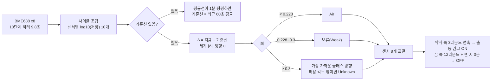

# WARD — 냄새를 구분하는 퍼스널 발향 공기청정기 (향기·악취 판정)

인천대학교 2026 캡스톤디자인 · 팀 **써드임팩트(THIRDIMPACT)**

향을 뿌리는 공기청정기는 자기가 뿌린 향까지 빨아들인다. WARD 와드(BME688 Development Kit, 가스센서 8개)는
**방 안의 냄새가 공기인지, 우리가 뿌린 향인지, 악취인지** 판정해 악취일 때만 공기청정기 출동을 권고한다.

| 판정 | 예 | 공기청정기 |
|---|---|---|
| 공기 | 평소 공기, 물 분무 | 끔 |
| 향기 | 페퍼민트 · 라벤더 · 오렌지 (우리가 뿌린 향) | **끔** |
| 악취 | 식초에 적셔 말린 양말, 처음 보는 냄새 | **켬** |

**판정 규칙은 C 파일 하나(`firmware/ward/ward_infer.h`)에만 있고**, 와드와 PC 가 같은 코드를 쓴다.

| 어디서 | 코드 | 역할 |
|---|---|---|
| **와드 (ESP32, 배터리)** | `firmware/ward/` | 측정하면서 직접 판정 → MQTT `diffuser/ward-01/inference_ward` |
| **노트북 / Jetson** | `tools/ward_engine.py` → `ward_infer.h` | 같은 C 코드를 gcc 로 빌드해 파이썬에서 부름 (실시간 판정·녹화 재생·성능 평가·모델 갱신) |

그래서 **노트북에서 녹화를 재생한 결과가 곧 와드 동작**이다(재생 805판정 100% 동일).

**대시보드·주행 Jetson 과의 연동 형식은 [INTERFACE.md](INTERFACE.md)** (MQTT 판정 JSON, ROS 2 `/ward/decision`·`/ward/event`, 출동 흐름).

> 원시 녹화·라벨 데이터(`training/`)와 자격증명(`secrets.h`)은 저장소에 올리지 않는다.
> 이전 `ward_bme688/firmware/*`(HP-354 히터, BSEC 분류)와는 **히터 설정이 달라 데이터가 호환되지 않는다.**

---

## 1. 한눈에 보는 흐름



## 2. 왜 이 방식인가 (신경망 대신 "방향 비교")

| 단계 | 이유 |
|---|---|
| **기준선을 뺀다 (Δ)** | 금속산화물 센서는 날마다·시간마다 값이 흘러간다(드리프트). 바로 앞 평평한 공기와의 차이만 보면 흘러간 만큼이 지워진다 |
| **방향으로 비교한다 (u = Δ/\|Δ\|)** | 같은 냄새가 진하거나 옅으면 크기만 바뀌고 방향은 같다. 실측: 라벤더를 멀리서/바짝 대고 잰 방향 차이 1.5° |
| **세기가 약하면 보류** | 약한 신호는 무엇이든 비슷한 방향으로 납작해진다. 실측: \|Δ\| 0.2 이하에서 방향이 맞는 비율 84% 이하 → 문턱 0.3 |
| **허용 각도 밖 = Unknown** | 처음 보는 냄새를 아는 클래스로 억지로 부르지 않는다. Unknown 은 출동 쪽 |
| **8센서 표결 + 연속 조건** | 센서 하나·사이클 하나의 실수로 청정기가 켰다 껐다 하지 않게 |

**모델 비교 실측**(녹화 단위 교차검증): 방향으로 정규화한 입력이면 각도·LDA·SVM·랜덤포레스트·kNN·신경망(MLP) 모두 ≥99%.
정규화 없이 크기를 그대로 넣으면 SVM 0.9%, MLP 66% 로 무너졌다 → **성능은 모델보다 전처리가 결정한다.**
각도 방식은 숫자 몇 개라 ESP32 에 그대로 들어가고, "식초는 우리 향과 27° 떨어져 있다"처럼 설명할 수 있다.

## 3. 폴더

```
├── README.md · requirements.txt · .gitignore
├── firmware/
│   ├── ward/                    와드 펌웨어 하나로 수집·판정 (config.h 의 WARD_WIFI 1=배터리·MQTT / 0=USB 수집 전용)
│   │   ├── ward.ino             측정 루프, MQTT 태스크(core 0), 판정 결과 발행, 무선 모델·원격 명령 받기
│   │   ├── ward_infer.h         ★ 판정 규칙 (순수 C — 와드와 PC 가 같이 씀)
│   │   ├── model.h              ★ 펌웨어에 고정되는 기본 모델 (export_model.py 가 생성)
│   │   ├── config.h             device_id, 토픽, WARD_WIFI, WiFi 송신 출력
│   │   ├── secrets.h.example    → secrets.h 로 복사해 WiFi·HiveMQ 값 입력 (커밋 금지)
│   │   └── commMux.h/.cpp       DevKit 8센서 SPI 선택
│   └── bme688_iaq_mqtt/         공기질(BSEC IAQ) 표시용 — 보류
├── model/openset_model.json     지금 쓰는 판정 모델        model/history/  이전 모델 (되돌리기용)
├── tools/                       파이썬 도구 (아래 표)
└── training/                    녹화·라벨 데이터 (커밋 안 함)
```

| 도구 | 하는 일 |
|---|---|
| `capture_serial.py` / `mqtt_capture.py` | USB / MQTT(배터리) 로 녹화 → `training/recordings/` (실시간 그래프 `live_view.py`, 끝나면 라벨링 `label_tool.py`) |
| `update_model.py` | ★ 학습 → 성능 검사 → 펌웨어 검사 → 통과하면 모델 교체 (`--push` 와드로 전송, `--rollback`) |
| `ward_engine.py` | 판정 엔진 — `ward_infer.h` 를 gcc 로 빌드해 부름 (헤더가 바뀌면 자동 재빌드) |
| `ward_controller.py` | 실시간 판정 → 청정기 명령 / `--replay` 녹화 리허설 / `--port COM5` USB 로 바로 |
| `replay_eval.py` | 녹화를 하나씩 빼고 학습 → 재생 → 악취 출동률·잘못 출동 횟수 |
| `ward_view.py` | 와드 판정(MQTT) 한글로 보기 · `--rebase` 기준선 다시 · `--reboot` 재시작 |
| `push_model.py` · `export_model.py` | 모델 → 와드(무선) / → `model.h` |
| `firmware_parity.py` | 히터 설정 펌웨어 == 파이썬, model.h 컴파일, 무선 모델 읽기 시험 |
| `open_set.py` · `baseline_correct.py` · `parse_devkit_csv.py` · `session_id.py` · `paths.py` | 학습·공용 |

## 4. 빠르게 시작

```powershell
pip install -r requirements.txt          # + gcc (Windows: MinGW-w64 64비트, Jetson: 기본 gcc)
cd tools
python capture_serial.py --port COM5 --name day1      # USB 로 수집 → 라벨링
python update_model.py                                 # 학습·검사·교체
python ward_controller.py --replay ..\training\recordings\rec_....csv   # 리허설 (와드와 같은 판정)
python ward_view.py                                    # 배터리 와드 판정 보기
```
펌웨어는 Arduino IDE(Adafruit ESP32 Feather, core 2.0.17)로 `firmware/ward` 를 올린다.
스케치북 위치 = Bosch BME68x 라이브러리가 있는 폴더(`libraries/`), **경로에 한글 금지**(링커 오류).
MQTT 자격증명은 `secrets.h`(커밋 안 됨)와 환경변수 `MQTT_BROKER/MQTT_USER/MQTT_PASS` 로만.

## 5. 판정 모델 (`model.h`)

모델 전체가 이것뿐이다 (2026-11-05, 녹화 8개로 학습, id `75b9571e24`):

| 클래스 | 출동 | 허용 각도 | 학습 녹화 |
|---|---|---|---|
| Lavender | 끔 | 35.2° | 3 |
| Orange | 끔 | 18.9° | 2 |
| Peppermint | 끔 | 8.0° | 1 |
| **Vinegar** (식초에 적셔 말린 양말) | **출동** | 35.6° | 4 |

- 문턱: Air < **0.228** ≤ 보류 < **0.300** ≤ 판정
- 클래스마다 "평균 방향" 숫자 10개(히터 10단계)가 들어 있다. 판정 = 지금 방향과 각 평균 방향의 각도 비교.
- 데이터가 늘면 허용 각도가 좁아진다: Vinegar 는 이틀치 72° → 3일치 36°, Lavender 44° → 35°.
- 모델 id 는 내용으로 정한다(학습 시각 제외) — 같은 데이터·설정이면 같은 id.

## 6. 와드 펌웨어의 판정 (`ward_infer.h`)

| 상태 | 메모리 |
|---|---|
| (센서, 단계)별 최근 값 24개 — 기준선 계산 | 약 15 KB |
| 라운드(센서 8개가 한 사이클씩) 평균선 64개 — 평평한지 확인 | 0.5 KB |
| 기준선, 표결, 연속 카운터 | 수백 바이트 |

빌드 결과(Adafruit ESP32 Feather, core 2.0.17): 프로그램 69%, 전역 메모리 22%.

**처리 순서** (`wi_feed` 에 측정 행 1개씩):
1. Gas Valid 인 행만 받아 센서별로 10단계를 모은다. 단계 번호가 되감기면 사이클 끝.
2. 기준선 전: 라운드 평균선이 60초 동안 0.05 안에서 평평하면 최근 60초 평균을 기준선으로.
3. 기준선 후: Δ → `wi_predict`(Air/보류/클래스/Unknown) → 센서 8개가 모이면 `wi_decide`.
4. `wi_decide`: 표결 → 켬/끔 연속 카운트 → ON/OFF 권고. Air 가 이어지면 기준선을 아주 천천히 따라가고(2%/라운드),
   청정기 꺼진 채 Air 가 3분 평평하면 기준선을 새로 잡는다(예열 끝무렵 드리프트 대응).
   청정기 켜진 채(켠 뒤 3분 지나) 켬 쪽 판정이 최근 6라운드(약 1분) 평평해도 기준선을 새로 잡는다(차가운 시작 기준선에 갇혀 계속 켜지는 것 방지).
5. 기본 파라미터(3라운드·12라운드·180초…)는 `wi_default_params()` 한 곳 — PC 도구도 여기서 읽는다.

**냄새 세기 % (`strength_pct`)** — 센서 값이 깨끗한 공기에서 얼마나 멀리 움직였는지(Δ 의 길이 |Δ|, 센서 8개 중앙값)를 % 로 바꾼 것.
금속산화물 센서는 가스가 진할수록 로그 저항이 더 크게 변하고, 같은 냄새는 진해져도 방향은 그대로 길이만 길어진다(실측: 멀리/바짝 1.5°).
`(|Δ| − 0.228) ÷ (1.0 − 0.228) × 100` — 0% = 깨끗한 공기 경계, 100% = 데모 위치에서 세 향을 진하게 뿌린 정도.
**상대 세기이지 농도(ppm)가 아니고**, 냄새마다 감도가 달라 같은 냄새끼리 비교할 때 의미가 있다. 실측: 세 향 동시 10초 → 최고 59%, 창가 식초 양말 → 17~31%.

**MQTT 출력** `diffuser/ward-01/inference_ward` (판정마다, 약 10초):
```json
{"device_id":"ward-01","src":"ward","model":"75b9571e24","uptime_s":812,
 "state":"MALODOR","label":"Vinegar","label_note":"","mag":0.512,"votes":7,"n":8,
 "purifier":"on","event":"ON","alert":{"malodor":true},"baseline_age_s":420}
```
`state`: `WARMUP`(기준선 전, 10초마다) / `CLEAN` / `SCENT`(우리 향, label_note "추정") / `MALODOR` / `UNKNOWN` / `HOLD`(보류).
시리얼에도 `# I …` 한 줄씩 나온다(‘#’ 로 시작해 수집 CSV 에는 안 섞임).

**원격 명령** `diffuser/ward-01/cmd` (retained 아님, 답장은 `/model/ack`):
```powershell
python tools/ward_view.py --rebase   # 기준선만 다시 잡기 — 센서는 데워진 채, 1분 평평하면 새 기준선
python tools/ward_view.py --reboot   # 와드 재시작 (RESET 버튼과 같음, 켠 지 30초 안에는 무시)
```
**데모 시작 순서**: 와드 켜고 15분 예열 → `--rebase` → 깨끗함이 2분 이어지면 시작. 악취 통은 와드에서 멀리서 연다(여는 것만으로도 출동).

## 7. 성능 (청정기 동작 기준, 녹화를 하나씩 빼고 학습 → 그 녹화를 와드와 같은 엔진으로 재생)

| 항목 | 결과 |
|---|---|
| 식초 양말 → 출동 | **10/10** (서로 다른 날 4일) |
| 식초 양말 대고 출동까지 | 중앙 **29초** (최대 60초) |
| 꺼야 할 구간(공기·향·대조 양말)에서 잘못 출동 | **1번 / 224분** (시간당 0.3) |
| PC 판정 ↔ 와드 펌웨어 | **100% 동일** (같은 C 코드) |
| 실기 (11/04, 배터리 와드) | 식초 양말 → 와드가 직접 악취 출동 / 오렌지 1분 분무 → 출동 없음 / 무선 모델 교체 성공 |
| **데모 흐름 리허설 (11/05)** | 식초 양말 → 42초 만에 출동 → 세 향 동시 분무 중 재출동 없음 → 켠 지 5분 반에 스스로 끔 |

**판정에 걸리는 시간**: 사이클 9.8초 × (냄새가 센서까지 오는 10~20초 + 연속 3라운드) ≈ 30초.

## 8. 모델 갱신 · 와드 반영

```powershell
cd tools
python update_model.py             # 학습 → 성능 검사 → 펌웨어 검사 → 통과하면 교체 + model.h 생성
python update_model.py --push      # + MQTT 로 와드에 바로 전송 (펌웨어 다시 올릴 필요 없음)
python update_model.py --rollback  # 이전 모델로 되돌림 (model/history/)
```
통과 기준: 악취 출동 ≥90% · 잘못 출동 ≤ 시간당 1번 · 히터 설정 일치 · model.h 컴파일·무선 모델 읽기 정상.
못 미치면 지금 모델을 그대로 두고 이유를 보여 준다.

```
노트북 push_model.py ─ MQTT diffuser/ward-01/model (retained, 글자 형식 + CRC-32) ─▶ 와드
                                                                    검사 → 적용 → NVS 저장
노트북 ◀─ diffuser/ward-01/model/ack {"result":"ok|same|error|reset","model":"<id>"} ─┘
```
- 와드가 꺼져 있어도 retained 라 켜져서 MQTT 에 붙는 순간 받는다. 재부팅해도 저장된 모델을 쓴다.
- 와드는 체크섬·숫자 범위·방향 벡터 길이를 검사하고, 실패하면 **지금 모델을 유지한 채** 이유를 답한다.
- `python push_model.py --reset` → 저장된 모델을 지우고 펌웨어 기본 모델(`model.h`)로.

**펌웨어 업로드**: Brownout(USB + 팬 + WiFi 시작 전류)으로 재부팅이 반복되면 팬 선을 잠깐 빼고 올린다. WiFi 송신은 8.5dBm(`config.h`).

**지켜야 할 것**
- 히터 설정(`ward.ino` 의 `tempProf {400,400,200,220,250,280,310,340,370,400}`, `mulProf`, `MEAS_DUR 140`)을 바꾸면 그때까지 모은 데이터를 쓸 수 없다.
  `tools/parse_devkit_csv.py` 의 `STEP_TEMPS` 와 같은지 `firmware_parity.py`·`update_model.py` 가 자동으로 확인한다.
- 판정 규칙은 `firmware/ward/ward_infer.h` **한 곳만** 고친다 → `python tools/replay_eval.py` 로 성능 확인 → 와드에 업로드.
- 와드는 수집·데모 중 움직이지 않는다(옮기면 기준선이 어긋나 잘못 출동).

## 9. 한계와 다음 단계
- **향 이름 구분은 어렵다**: 우리 향 3종의 방향 차이 2~4° = 같은 향의 날짜별 흔들림과 같은 크기. 이름은 분무 기록(아두이노가 켠 채널)으로 표시한다.
- 데모 위치에서 오렌지처럼 약한 향은 Orange/보류/Air 가 오락가락한다(출동은 안 함) → 대시보드는 최근 몇 라운드로 부드럽게 표시.
- 다음: 발향 시점을 와드에 알려 발향 잠금 연결, 습도 보정, 센서별 신뢰도 가중. 악취 종류가 늘면 신경망과 같은 조건(`replay_eval.py`)으로 비교.
