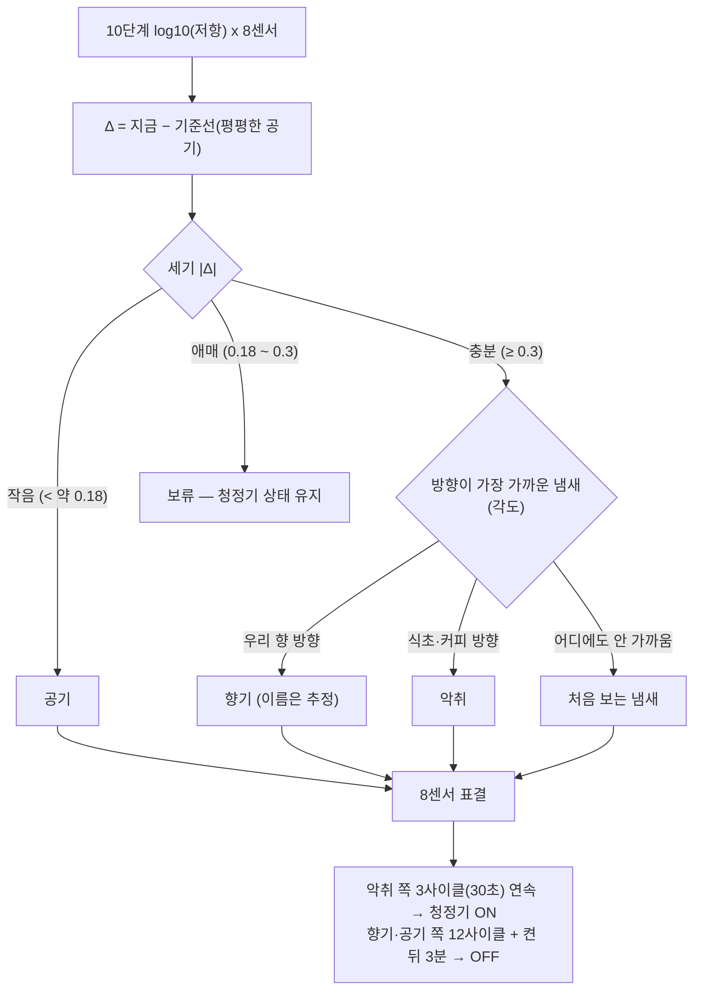
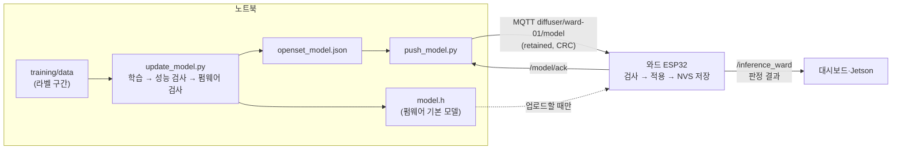

# 시스템 구조

## 한 줄 요약
와드(가스센서 8개)가 9.8초마다 원시 측정값을 MQTT 로 보내면, Jetson 이 **평소 공기와의 차이**를 계산해
`공기 / 향기 / 악취`를 판정하고, 악취일 때만 공기청정기를 켜며 결과를 대시보드에 띄운다.

## 구성

```mermaid
flowchart LR
  subgraph WARD["와드 (배터리)"]
    S["BME688 x8<br/>10단계 히터"] --> F["ESP32 Feather"]
    FAN["팬 (상시)"] -.공기.-> S
  end
  F -- "MQTT TLS<br/>inference_ward (판정)<br/>sensor (원시값)" --> B[("HiveMQ Cloud")]
  subgraph UI["UI(키오스크) Jetson 192.168.10.1"]
    WB["ward_bridge_node<br/>(ROS 2, 예정)"] --> NB["ros_nav_bridge"] --> D["대시보드 7인치<br/>useScentMissionNav"]
    D --> FB["fragrance_bridge"]
  end
  B --> WB
  FB -- "USB 시리얼" --> A["Arduino<br/>청정기 팬 + 발향 3채널"]
  NB <-- "유선 LAN · ROS 2<br/>/go_to_goal · /go_around ↔ /arrival_at_goal · status" --> R["주행 Jetson 192.168.10.2<br/>third_impact: AMCL · Nav2<br/>정찰 + 와드로 정밀 복귀"
```
메시지 형식(토픽·JSON·ROS 토픽)은 [INTERFACE.md](../INTERFACE.md).

| 부품 | 역할 |
|---|---|
| BME688 Development Kit | 가스센서 8개 + Adafruit HUZZAH32(ESP32) Feather. 3.7V 5000mAh 배터리, 팬은 배터리 직결 |
| UI(키오스크) Jetson Orin Nano | 대시보드(7인치), 와드 판정 받기, Arduino(청정기·발향) 제어, 주행 명령 |
| 주행 Jetson | SLAM·Nav2·AMCL — 와드가 있는 방으로 공기청정기 이동 |
| Arduino (`air_control`) | 공기청정기 팬(핀2), 가습기 MIST1 핀3=페퍼민트 · MIST2 핀4=라벤더 · MIST3 핀5=오렌지 |
| HiveMQ Cloud | MQTT 브로커 (TLS 8883) |

## 센서가 재는 것
BME688 은 **금속산화물(MOX) 가스센서**다. 히터로 칩을 데우면 공기 중 휘발성 물질에 따라 전기저항이 바뀐다.
온도마다 반응하는 물질이 달라서, 한 사이클(9.8초)에 10단계 온도를 돌며 저항을 잰다 → **냄새 하나 = 숫자 10개 × 센서 8개**.

| 단계 | 0 | 1 | 2 | 3 | 4 | 5 | 6 | 7 | 8 | 9 |
|---|---|---|---|---|---|---|---|---|---|---|
| 온도(℃) | 400 | 400 | 200 | 220 | 250 | 280 | 310 | 340 | 370 | 400 |

## 판정 방식



- **왜 차이(Δ)인가**: MOX 센서는 날마다 기준값이 흘러간다(드리프트). 절대값 대신 바로 앞 평평한 공기와의 차이를 쓰면 이 흔들림이 지워진다.
- **왜 방향(각도)인가**: 같은 향이 진하거나 옅으면 크기만 바뀌고 방향은 같다. 방향으로 비교하면 농도에 덜 흔들린다.
- **왜 보류가 있나**: 약한 신호는 무엇이든 비슷하게 납작해져서 구분이 안 된다(측정 근거는 [실험_결과.md](실험_결과.md)).
- **왜 표결·연속 조건인가**: 센서 하나·사이클 하나의 실수로 청정기가 켰다 껐다 하지 않게.

## 냄새 세기(%)는 어떻게 재나 (11/09)

**한 줄**: 냄새가 오면 센서 값이 깨끗한 공기에서 **얼마나 멀리** 움직였는지(화살표 길이)가 세기, **어느 쪽으로** 움직였는지(화살표 방향)가 냄새 종류다.

```
            ↗ 식초 (방향이 다름 → 악취)
깨끗한 공기 ●──────→ 향기 진하게 (길이 김 = 세기 큼)
            ──→      향기 옅게   (방향 같음, 길이만 짧음)
```

1. **센서 원리** — 금속산화물(MOX) 센서는 가스 분자가 표면에 붙으면 전기 저항이 바뀐다. 가스가 진할수록 더 많이 바뀌고,
   저항의 로그값 `log10(R)` 은 농도의 로그에 거의 비례한다(MOX 센서의 일반적 성질). 그래서 **로그 저항의 변화량이 클수록 진한 냄새**다.
2. **10단계 지문** — 히터를 10가지 온도로 돌며 잰다. 센서 하나가 한 사이클에 숫자 10개를 내고,
   바로 앞 평평한 공기(기준선)를 빼면 변화량 Δ (10개 숫자) = 화살표 하나가 된다.
3. **세기 = 화살표 길이** `|Δ| = √(Δ₁² + … + Δ₁₀²)`. 센서 8개의 중앙값을 쓴다(한두 개 튀는 센서 무시).
   **종류 = 화살표 방향** `u = Δ / |Δ|` — 학습한 냄새의 평균 방향과 각도로 비교한다.
4. **% 로 바꾸기** — `세기% = (|Δ| − 0.228) ÷ (1.0 − 0.228) × 100`, 0~100 으로 자른다 (`ward_infer.h` `wi_strength_pct`).
   - 0% = 깨끗한 공기 경계 τ_air 0.228 (Air 구간 흔들림에서 학습)
   - 100% = |Δ| 1.0 (11/05 데모 위치에서 세 향을 몇 분 진하게 뿌렸을 때 0.98~1.22)

**근거 (실측)**
| 확인한 것 | 결과 |
|---|---|
| 같은 향을 멀리서/바짝 대고 | 방향 차이 1.5°, **길이만 달라짐** → 길이 = 세기, 방향 = 종류로 나눠 볼 수 있다 |
| 세 향 동시 10초 분무 (11/09) | 18~59% 오르락내리락 → 1분 반 뒤 0% |
| 식초 양말, 창가·창문 열림 (11/09) | 17~31% (평소 양말 \|Δ\| 0.4~0.9 ≈ 25~85%) — 바람에 흩어지면 낮게 나온다 |
| 우리 향 ↔ 식초 방향 | 약 24° 떨어짐 → 세기가 약해도(31%) 종류는 식초로 맞게 판정 |

**한계 — 이 % 가 아닌 것**
- **농도(ppm)가 아니다.** 같은 기준으로 비교한 상대 세기다. 몇 ppm 인지 말하려면 방울 수를 바꿔(10·20·40방울) 맞춰 보는 보정이 필요하다.
- **로그 성질** — 두 배 진하다고 % 가 두 배가 되지 않는다.
- **냄새마다 센서 감도가 다르다** — 식초 50% 와 라벤더 50% 가 같은 농도라는 뜻은 아니다. 같은 냄새끼리 비교할 때 의미가 있다.
- **위치·바람·청정기 영향** — 안개 길에서 벗어나거나 창문이 열리면 낮아지고, 청정기가 돌면 신호가 약 1/10 이 된다.
- **습도도 길이를 늘린다** — 물만 뿌려도 Δ 가 커진다(방향은 향과 비슷). 그래서 Water 대조군을 둔다.
- **향 이름에는 % 를 붙이지 않는다** — 우리 향 3종은 방향이 1~4° 차이라 "페퍼민트 50%" 같은 이름 확률은 근거가 없다. 이름은 분무 채널(`spraying`)로 보여 준다.

## 판정 코드는 한 곳 (11/09)
판정 규칙은 **와드 펌웨어의 C 파일 `ward_infer.h` 하나**에만 있다.
- 와드: 이 코드로 직접 판정해 `inference_ward` 로 보낸다.
- 노트북·Jetson: `tools/ward_engine.py` 가 같은 파일을 gcc 로 공유 라이브러리로 빌드해 부른다(`ward_controller.py`·`replay_eval.py`·`update_model.py`).
- 그래서 **노트북에서 녹화를 재생한 결과가 곧 와드 동작**이다. 11/04~05 에는 파이썬·C 두 벌이라 라운드 일치 78~92% 를 맞추느라 애먹었다 → 하나로 합침(재생 805판정 100% 동일).



- **모델 = 숫자 몇십 개**: 클래스마다 평균 방향 10개 + 허용 각도, 문턱 2개 (1KB 미만).
- **무선 교체**: 와드는 받은 모델의 체크섬·숫자 범위·방향 벡터 길이를 검사하고, 실패하면 지금 모델을 유지한 채 이유를 답한다.
  저장된 모델은 재부팅해도 유지되고, `push_model.py --reset` 으로 펌웨어 기본 모델로 돌아간다.

## 판정 결과 메시지 (`diffuser/ward-01/inference_ward`, 와드가 약 10초마다)
```json
{"device_id":"ward-01","src":"ward","model":"3d35e257d8","uptime_s":812,
 "state":"MALODOR","label":"Vinegar","label_note":"","mag":0.512,"votes":7,"n":8,
 "purifier":"on","event":"ON","alert":{"malodor":true},"baseline_age_s":420}
```
상태: `WARMUP`(기준선 전) / `CLEAN` / `SCENT`(우리 향, "추정") / `MALODOR` / `UNKNOWN` / `HOLD`(보류).
Jetson 판정 결과는 `/inference` 로 같은 형식을 쓸 예정.

## 폴더
```
firmware/ward/            와드 펌웨어 하나 (수집·MQTT·온디바이스 판정, WARD_WIFI 0/1) — ward_infer.h = 판정 규칙
firmware/bme688_iaq_mqtt/ 공기질 펌웨어 (보류)
model/                    판정 모델 + history/
tools/                    수집·라벨링·학습·판정 파이썬 도구 (판정은 ward_engine 이 ward_infer.h 를 부름)
training/                 녹화(recordings) + 라벨 구간(data) — git 에 안 올림
docs/                     문서
(11/09 부터 이 폴더가 git 저장소. 팀 저장소 ward_bme688/inference 에는 tools/publish_team.py 로 올림)
```
